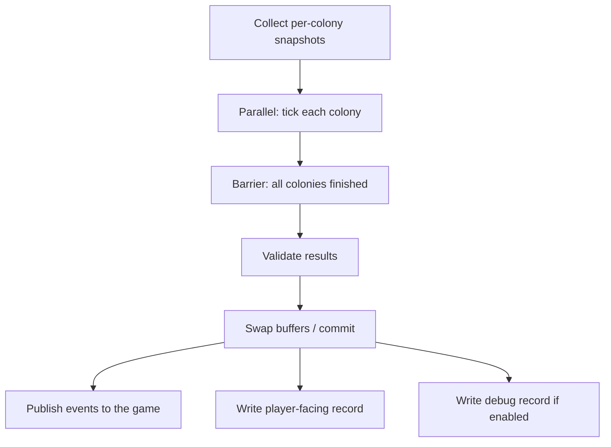

# Economy Implementation

This document describes the high-level shape of the economy code. It deliberately avoids implementation details — data structures, algorithms and formulas are specified in [economic-model.md](./economic-model.md).

## Position in the codebase

The economy lives as a module inside `src/Simulation`, the project that owns the game core. It is not a separate project: the economy is one of the systems that evolve the game state, and it shares the game's resource and colony definitions.

The economy module is **the only place that mutates economic state**. Other systems (colony founding, construction, policy) hand the economy a snapshot of the colony and receive the results of the tick back. Nothing else reads or writes household and corporation ledgers directly.

The module boundary is intentionally narrow:

- **Inputs**: the per-colony economic state (households, corporations, buildings, stocks, price beliefs), the colony's non-economic context, and the turn number.
- **Outputs**: the new economic state for each colony, plus the events the rest of the game needs to know about (corporations founded, corporations dissolved, households starved, prices settled).

## The economic tick

There is one economic tick per 7-day in-game period, at the end of the period.

**The tick is blocking.** When the 7-day period ends, game time stops until the tick has finished for every colony. The game does not render new state, accept new player input, or advance simulation time in the middle of a tick. This keeps the tick atomic: from the game's point of view the economy jumps from one consistent state to the next, and there is never a half-finished tick visible anywhere.

The tick runs on the server, in the same process as the simulation. Clients do not compute the economy; they receive the results.

## The tick is a pure function per colony

The core of the module is a single pure function:

```
ColonyEconomy → ColonyEconomy
```

It takes the economic state of one colony and returns the next economic state of that colony. It has no side effects: it does not touch global state, it does not read the state of another colony, and it does not mutate its input.

This shape is what makes the rest of the design work:

- **Per-colony independence is guaranteed by construction.** The economic model is independent for every colony — households, corporations and markets all live in a single colony. The pure function makes that independence a structural property rather than a discipline: there is no way for one colony's computation to reach into another's.
- **Testing is straightforward.** A tick can be tested in isolation with a hand-built colony state, and the worked examples from the model spec become test cases directly.
- **Rollback is trivial.** Because the input is never mutated, a tick that produces an invalid result can simply be discarded.

**Credits are the one global resource, and they do not break this.** Credits are a virtual resource with a global pool, but every credit transfer happens inside a single colony's market. The global money supply is the sum of the per-colony ledgers, so a colony's tick can be computed without knowing anything about other colonies. The same reasoning applies to standard resources (stocks are per-colony) and instant resources (labour and energy are consumed and destroyed within the colony that produced them).

## Double-buffered state

The tick does not mutate the live game state in place. It computes the next economic state into a **second buffer**, and the buffers are swapped once every colony has finished.

This gives the tick an atomic commit point:

1. The live state is read-only for the whole duration of the tick.
2. Every colony's result is written into the next-state buffer.
3. When all colonies are done, the buffers are swapped. The game sees the new state; the previous state becomes the read-only buffer for the next tick.

Consequences worth noting:

- **All colonies commit at the same instant.** No colony is half updated.
- **The previous state stays available** after the commit, which is what makes replay, debugging and the future asynchronous precompute possible.
- **Events are collected during the tick** (founding, dissolution, starvation, settlement prices) and published to the rest of the game at the commit, so other systems see one coherent batch of changes rather than a stream of partial updates.

## Determinism

The economy must be deterministic: the same starting state and the same turn number must produce the same result, every time, on every machine.

This is required for multiplayer (the server and clients must agree on the outcome), for replay, and for regression tests. It is also what makes threading safe.

**Randomness lives only in order generation, never in settlement.** The market's settlement price, rationing and clearing are fully deterministic given the orders. The stochastic parts of the model are the founding roll, sector sampling and order price sampling.

**RNG is seeded per colony, derived from the colony identity and the turn number.** Each colony's tick consumes only its own RNG stream. This means:

- The order in which colonies are processed by threads does not affect any result.
- A colony's economy can be replayed on its own, without recording the rest of the game.
- Adding or removing colonies does not shift the RNG stream of the others.

## Threading

Colonies are processed concurrently, using a **thread pool** and a parallel loop over the list of colonies. Each colony is one unit of work.

The design constraints that make this safe:

- The tick function is pure and per-colony, so there is **no shared mutable state** between workers.
- Each worker owns its own RNG stream, so workers do not contend on randomness.
- Results are written into disjoint slots of the next-state buffer, so workers do not contend on output.
- The tick ends with a **barrier**: the commit happens only after every colony has finished.

A thread pool (rather than one thread per colony) keeps the cost proportional to the number of CPU cores, not the number of colonies. A job queue of individual `(colony, resource)` market tasks is not needed at expected scale: the per-market cost is `O(N log N)` in the number of orders, and a turn costs `O(C · R · N log N)` overall, which is not a bottleneck. If profiling ever shows a hot colony, work can be split below the colony level later.

## Two separate output streams

**From day one, the data captured for the player UI and the data captured for debugging are separate.** They are two distinct outputs of the tick, with separate types, separate storage, and separate lifetimes. They must not be merged into a single record, because the debug stream has to be switchable off later — in a shipped game, and in a large multiplayer session — without touching the player-facing path.

The tick produces three things:

1. **The next economic state** (the double-buffered result).
2. **The player-facing record** — the small, stable set of derived numbers the UI needs: settlement prices, stock coverage, food demand versus filled, labour supplied and employed, corporation counts and status, household counts and wealth, and the events. This is what is sent to clients, and what the player charts are built from.
3. **The debug record** — the full per-turn snapshot: every household, corporation and building, every order with its price, quantity and fill, the settlement sweep, and the planning trace. This is developer-only, is never sent to clients, and is written to a separate store.

The rules that keep them separate:

- **The debug stream is derived from the state, not from the player stream.** The debug record is built from the tick's internal working data. The player record is built from the committed state. Neither is built from the other, so removing the debug stream cannot break the player UI.
- **The player stream is a fixed, small contract.** It contains only the numbers the UI spec lists. It does not grow to accommodate a debugging convenience. If a debug need appears, it goes into the debug stream.
- **The debug stream is gated by a flag from the start.** Recording is controlled by a single switch (per colony, per turn range, or globally), and the code path that writes the debug record is compiled and run only when the switch is on. Turning it off must cost nothing: no allocation, no copy, no serialization.
- **Nothing in the game reads the debug stream.** The player UI, the client protocol, and the simulation all read only the player stream. This is what makes the debug stream safely removable.
- **The debug stream is not part of the network protocol.** It never crosses the server/client boundary, so its size and shape can change freely without affecting multiplayer.

The consequence to accept up front: some numbers appear in both streams (prices, totals, corporation status). That duplication is intentional and cheap. The player stream is the contract; the debug stream is the diagnostic. Keeping them separate is what lets the debug stream be turned off.

## Tick pipeline

The tick is a fixed sequence of stages. The per-colony stage runs in parallel; the surrounding stages run once.



Inside one colony, the stages are exactly the turn sequence from the model spec: founding roll, order submission, settlement, rationing, clearing, household consumption and population, production, destruction of unsold instant supply, price belief update, dissolution check.

**Validation before commit.** Each colony's result is checked against the model's invariants — credits conserved, standard resources conserved, no agent spends more than it has, prices inside `[PRICE_FLOOR, PRICE_CAP]`. A result that fails validation is a bug, and the tick must not commit a partially valid world: the whole tick fails, and the failure is reported with the colony that produced it.

## Player actions and the tick boundary

Player actions that affect the economy are applied at the tick boundary, not during a tick. The tick reads the state as it was at the start of the period; anything the player does during the period is queued and becomes visible to the economy at the next tick.

This is a deliberate simplification: it keeps the tick a single pure function of a snapshot, and it means the economy never has to handle a changing input mid-computation.

## Testing hooks

The shape of the module is chosen so that the economy can be tested without the game:

- **Unit tests on the pure tick function**, driven by the worked examples in the model spec (market settlement, rationing, founding rolls, production planning, dissolution).
- **Invariant checks** as assertions that run in tests, and optionally in debug builds.
- **Determinism tests**: run the same colony state twice, and with a different number of threads, and compare the results exactly.
- **Golden snapshots**: a fixed starting world, ticked for a fixed number of turns, compared against a recorded result. This catches changes in tuning constants immediately.

## Future improvement: asynchronous precompute

Because there is one tick per 7 in-game days, the economy could be computed **during** the period rather than at the end of it: the tick for period N+1 can be computed in the background while the game is in period N, and only committed when the period ends. The game would then never block on the economy.

This is not done now, and the reason is player actions. Precomputing the tick means computing it from a snapshot taken before the player has finished acting. When a player action changes an economic input, the precomputed result is invalid and must be recomputed — and the recomputation must be fast enough not to block the period boundary. That invalidation machinery (tracking which inputs a colony's result depends on, and a recompute path) is significant work, and it is not worth it while the tick is cheap.

The current design keeps this option open: the pure per-colony function, the per-colony RNG seed and the double-buffered commit are exactly the pieces a precompute-and-commit scheme needs. Adding it later means computing the next buffer early, swapping it at the boundary, and checking the inputs for invalidation.

## Non-goals

Explicitly out of scope for this version:

- Inter-colony transport, which would introduce shared state between colonies and break per-colony parallelism.
- Interplanetary megacorporations, which would introduce agents that span colonies.
- Any form of continuous-time economy. The model is turn-based, and the tick remains a single atomic step.
